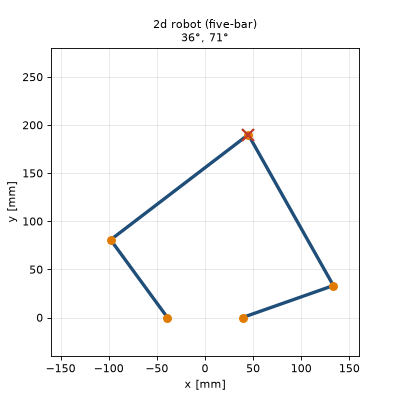
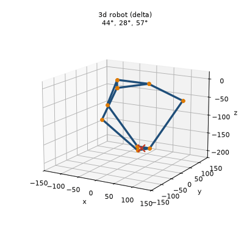
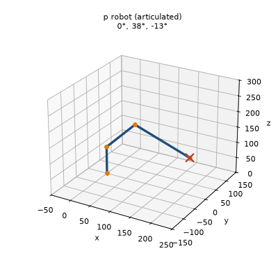
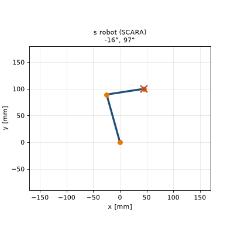
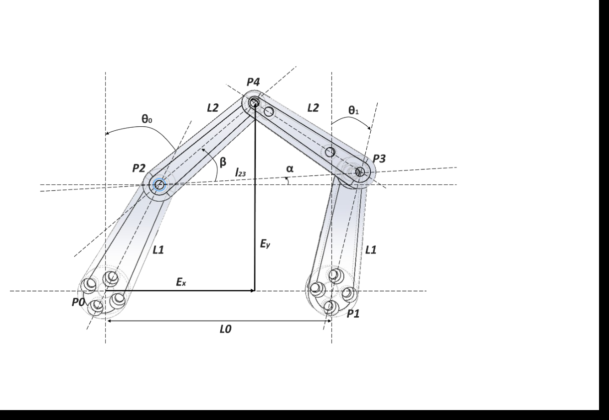
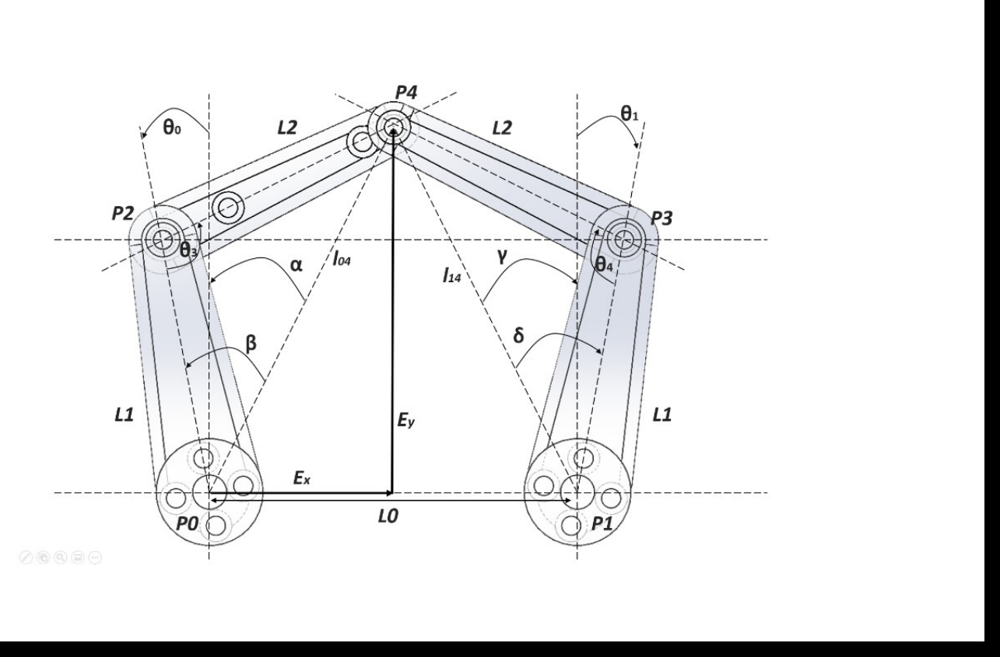
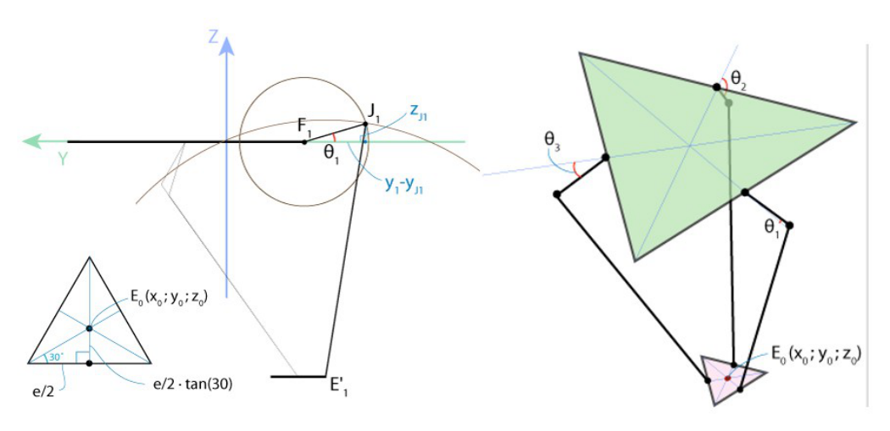
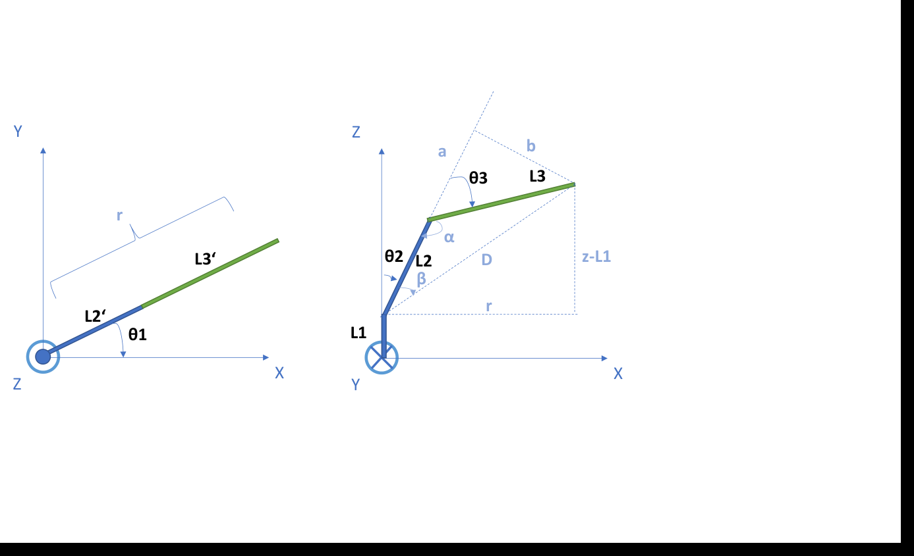
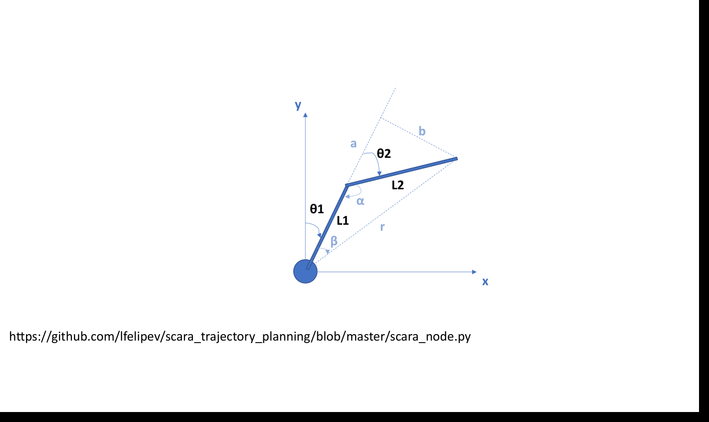

# Robot Kinematics: Four Small Robots

Closed-form **forward and inverse kinematics** for the four robots of *Chocko-station*, a 2021 group project in a mechatronics bachelor's course (group F): a small ROS-controlled station in which four servo-driven robots pick, move and place chocolate bars.

This repository is the kinematics part of that project, extracted and ported to Python 3, with round-trip tests and an animation for each robot.

| 2d robot: five-bar | 3d robot: delta | p robot: articulated arm | s robot: SCARA |
|:---:|:---:|:---:|:---:|
|  |  |  |  |

*In each animation the tool point follows a path (red ✕), the IK computes the joint angles and the FK draws the chain.*

## The four robots

| Robot | Type | Joints → output | Module |
|---|---|---|---|
| **2d** | planar five-bar parallel linkage | 2 base servos → (x, y) | [`five_bar_2d.py`](kinematics/five_bar_2d.py) |
| **3d** | delta (3 parallel arms) | 3 base servos → (x, y, z) | [`delta_3d.py`](kinematics/delta_3d.py) |
| **p** | articulated arm (yaw, shoulder, elbow) | 3 servos → (x, y, z) | [`articulated_p.py`](kinematics/articulated_p.py) |
| **s** | SCARA, two revolute joints + wheel axis | 2 servos + wheel → (x, y, z) | [`scara_s.py`](kinematics/scara_s.py) |

Angles are in degrees, lengths in mm. Every module has `forward_kinematics`, `inverse_kinematics` (raises `ValueError` for unreachable points) and `joint_positions` (for plotting).

### 2d robot: five-bar linkage

 

Servos $`P_0, P_1`$ at $`(\mp L_0/2,\ 0)`$, cranks $`L_1 = 100`$, distal links $`L_2 = 180`$, $`L_0 = 78.08`$ mm.

**Forward kinematics.** The crank tips are

```math
P_2 = \begin{pmatrix} -L_1\sin\theta_0 - \tfrac{L_0}{2} \\ L_1\cos\theta_0 \end{pmatrix},
\qquad
P_3 = \begin{pmatrix} L_1\sin\theta_1 + \tfrac{L_0}{2} \\ L_1\cos\theta_1 \end{pmatrix}
```

With $`l_{23} = \lVert P_3 - P_2 \rVert`$ and $`\alpha`$ the angle of $`\overrightarrow{P_2P_3}`$, the tool point is

```math
P_4 = P_2 + L_2 \begin{pmatrix} \cos(\alpha+\delta) \\ \sin(\alpha+\delta) \end{pmatrix},
\qquad
\delta = \pm\arccos\frac{l_{23}}{2L_2}
```

where the sign of $`\delta`$ picks the assembly mode.

**Inverse kinematics.** Each side is solved on its own. For the left servo, with $`l_{04} = \lVert P_4 - P_0 \rVert`$ and $`\alpha`$ the angle of $`\overrightarrow{P_0P_4}`$ from the vertical, the cosine rule in the triangle $`(L_1, L_2, l_{04})`$ gives

```math
\beta = \arccos\frac{L_1^2 - L_2^2 + l_{04}^2}{2L_1\,l_{04}},
\qquad
\theta_0 = \beta - \alpha
```

The right servo works the same way with $`\gamma`$ and $`\delta`$ (elbows out).

### 3d robot: delta



Base triangle $`f = 178.78`$, effector triangle $`e = 69.28`$, upper arms $`r_f = 96.1`$, forearms $`r_e = 150`$ mm.

**Inverse kinematics.** Each arm is solved in its own YZ plane. The elbow $`J_1`$ is where the circle of the upper arm (radius $`r_f`$ around $`F_1`$) meets the sphere of the forearm (radius $`r_e`$ around the shifted effector joint $`E_1'`$):

```math
\theta_1 = \arctan\frac{-z_J}{y_F - y_J}
```

Arms 2 and 3 use the same function after rotating the target by $`\pm 120^\circ`$.

**Forward kinematics.** The effector is where three spheres meet (radius $`r_e`$, centred at the elbows shifted inward by the effector radius). Eliminating $`x`$ and $`y`$ leaves a quadratic in $`z`$, and the lower root is taken:

```math
a z^2 + b z + c = 0
\quad\Rightarrow\quad
z = \frac{-b - \sqrt{b^2 - 4ac}}{2a},
\qquad
x = \frac{a_1 z + b_1}{d},\quad y = \frac{a_2 z + b_2}{d}
```

The derivation follows the well-known *Delta robot kinematics* tutorial from the Trossen Robotics community, applied to this robot's dimensions.

### p robot: articulated arm



Base height $`L_1 = 88.2`$, upper arm $`L_2 = 120.23`$, forearm $`L_3 = 150`$ mm. $`\theta_2`$ is measured from the vertical, and $`\theta_3' = \theta_3 + 90^\circ`$ so that $`(0, 0, 0)`$ is the zero pose (upper arm up, forearm horizontal).

**Forward kinematics.**

```math
r = L_2\sin\theta_2 + L_3\sin(\theta_2 + \theta_3'),
\qquad
\begin{pmatrix} x \\ y \\ z \end{pmatrix} =
\begin{pmatrix} r\cos\theta_1 \\ r\sin\theta_1 \\ L_1 + L_2\cos\theta_2 + L_3\cos(\theta_2 + \theta_3') \end{pmatrix}
```

**Inverse kinematics.**

```math
\theta_1 = \operatorname{atan2}(y, x),
\qquad
D = \sqrt{r^2 + (z - L_1)^2}
```

```math
\alpha = \arccos\frac{L_2^2 + L_3^2 - D^2}{2L_2L_3},
\qquad
\theta_3' = \pi - \alpha,
\qquad
\theta_2 = \frac{\pi}{2} - \arcsin\frac{z - L_1}{D} - \beta
```

where $`\beta`$ is the angle between $`D`$ and the upper arm.

### s robot: SCARA



$`L_1 = 92.75`$, $`L_2 = 70.72`$ mm. The third axis drives a wheel of radius $`R = 20`$ mm, so $`z`$ is the distance rolled.

**Forward kinematics.**

```math
x = L_1\sin\theta_1 + L_2\sin(\theta_1 + \theta_2),
\qquad
y = L_1\cos\theta_1 + L_2\cos(\theta_1 + \theta_2),
\qquad
z = R\,\theta_3
```

**Inverse kinematics.**

```math
r = \sqrt{x^2 + y^2},
\qquad
\theta_2 = \pi - \arccos\frac{L_1^2 + L_2^2 - r^2}{2L_1L_2},
\qquad
\theta_1 = \operatorname{atan2}(x, y) - \beta,
\qquad
\theta_3 = \frac{z}{R}
```

where $`\beta`$ is the angle between $`r`$ and $`L_1`$. The IK layout follows [lfelipev/scara_trajectory_planning](https://github.com/lfelipev/scara_trajectory_planning).

## Run it

```bash
pip install -r requirements.txt
python -m pytest -q                 # IK(FK(q)) == q for all four robots
python examples/roundtrip_demo.py   # one pose per robot, FK -> IK -> FK
python examples/animate.py          # re-renders the GIFs in docs/images
```

```
2d  five-bar  q=(  20.000,   35.000) deg -> p=(  22.823,  246.191) mm -> IK q=(  20.000,   35.000)  |dq|max=1.4e-14
3d  delta     q=(  10.000,   25.000,   40.000) deg -> p=(  17.121,  -27.281, -128.096) mm -> IK q=(  10.000,   25.000,   40.000)  |dq|max=1.4e-14
p   articul.  q=(  30.000,   20.000,  -15.000) deg -> p=( 165.021,   95.275,  188.106) mm -> IK q=(  30.000,   20.000,  -15.000)  |dq|max=3.6e-15
s   SCARA     q=( -40.000,   70.000,   90.000) deg -> p=( -24.259,  132.296,   31.416) mm -> IK q=( -40.000,   70.000,   90.000)  |dq|max=2.8e-14
```

The tests sample 500 random joint vectors per robot. Each closed-form IK returns one solution branch (five-bar elbows out, p-robot elbow in [−90°, 90°] reaching forward, SCARA elbow in (0°, 180°)), so the samples are limited to that branch.

## Changes from the 2021 code

- Ported from Python 2 / ROS Indigo to plain Python 3 with no ROS dependency. Plotting moved out of the kinematics modules.
- **Two bugs found by the new round-trip tests and fixed:**
  - *2d robot IK* used `atan(y/dx)`, which is 180° off for targets outside the span between the two servos. It now uses `atan2`, which gives the same result inside that span.
  - *s robot IK* used `π/2 − asin(y/r)` as the target bearing, which is only correct for x ≥ 0. It now uses `atan2(x, y)`.
- The equations and the robot dimensions are unchanged.

## Team & my contribution

Chocko-station was built by a team (group F). The full project included the ROS nodes, a teaching GUI, a camera, pumps, Arduino firmware and the station itself. It stays in a private repository. Teammate **Moritz Abdank** wrote a large share of the overall project (about 63 % of all commits).

**My part (Abdulhamid Baghdadi):** the robot kinematics in this repository. According to the git history, I wrote all four kinematics files and the four notation slide decks. I worked out the five-bar and articulated-arm models, adapted published delta and SCARA solutions to our geometry, and corrected the zero points during commissioning. In this extraction I also wrote the round-trip tests, the animations and the two bug fixes above.
